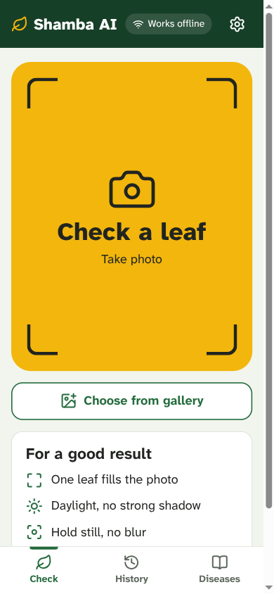
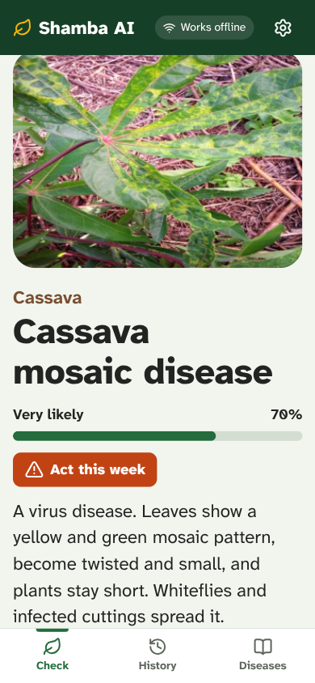
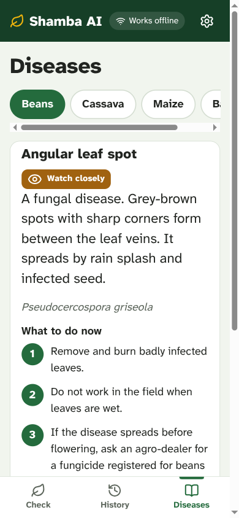

<div align="center">


# Shamba AI

**Check a crop leaf. Get advice. No internet needed.**

An open-source crop-health assistant for East African smallholder farmers.<br/>
The AI model runs on the phone, the laptop or in the browser with [PyTorch ExecuTorch](https://github.com/pytorch/executorch). Photos never leave the device.

[Open the web app](https://ganji759.github.io/shamba-ai/) ·
[Download the Android app](https://github.com/ganji759/shamba-ai/releases/latest) ·
[Model card](ml/MODEL_CARD.md) ·
[Architecture](docs/architecture.md) ·
[Business plan](docs/business/README.md)

[](https://github.com/ganji759/shamba-ai/actions/workflows/ci.yml)


</div>

<p align="center">
  
  
  
</p>

## The problem

- Cassava mosaic and brown streak diseases cost East and Central Africa over USD 1 billion a year ([review](https://pubmed.ncbi.nlm.nih.gov/28645239/)).
- In Kenya one extension officer serves 1,000 to 6,000 farmers. The recommended ratio is 1 to 400 ([WFP](https://innovation.wfp.org/node/375)).
- Many farms have weak or no signal. Mobile data costs USD 0.52 to 1.11 per GB in the target countries ([Les Afriques](https://lesafriques.com/en/2026/10/the-real-price-of-data-in-africa-ranking-of-53-countries-0-38-to-43-75-per-gb/)). A cloud AI app fails exactly where farmers need it.

## What Shamba AI does

1. The farmer takes a photo of one sick leaf.
2. A 2.7 MB model checks it on the device. No network call. On a 2017 laptop CPU one check takes 2 ms.
3. The app shows the disease, how sure it is ("Very likely", "Not sure"), how urgent it is ("Act today"), what to do now, how to prevent it, and when to call the extension officer. In Kiswahili, English or French. It can read the advice aloud.

v1 covers **14 conditions on 4 crops**: beans (angular leaf spot, rust), cassava (mosaic, brown streak, bacterial blight, green mite), maize (lethal necrosis, streak virus), banana (black Sigatoka, Fusarium wilt), plus healthy leaves for each crop.

## On-device AI with ExecuTorch

One PyTorch model. One export pipeline. Five ExecuTorch programs. Every platform.

```
timm MobileNetV4 ──fine-tune──▶ torch.export ──▶ to_edge_transform_and_lower ──┬─▶ XNNPACK int8  ─▶ Android, laptop CPU
 (field photos from                (normalize + softmax in the graph)            ├─▶ XNNPACK fp32  ─▶ Android, laptop CPU
  Uganda and Tanzania)                                                           ├─▶ WebGPU        ─▶ browser GPU (Wasm runtime)
                                                                                 ├─▶ portable      ─▶ browser CPU fallback
                                                                                 └─▶ Vulkan        ─▶ Android GPU
```

Measured results ([model card](ml/MODEL_CARD.md), [manifest](https://github.com/ganji759/shamba-ai/releases/tag/model-v1.0.0)):

| | Value |
|---|---|
| Test accuracy (1,226 held-out field photos, 14 classes) | **87.8%** |
| Test macro F1 | **88.6%** |
| Best crops | banana 95.9 to 99.5% F1, maize 95.0 to 99.0% F1 |
| Hardest crop | cassava 67.3 to 82.0% F1 (healthy vs early disease is hard to see) |
| Training | 50 minutes on a laptop CPU (Intel i5-8250U, no GPU) |

| ExecuTorch program | Size | Delegated ops | Accuracy vs eager (300 test photos) | Latency, i5-8250U |
|---|---|---|---|---|
| XNNPACK int8 | 2.7 MB | 100% | 88.0% (97.3% same top-1 as eager) | **1.9 ms** |
| XNNPACK fp32 | 10.0 MB | 100% | 87.7% (identical to eager) | 2.9 ms |
| WebGPU fp32 | 10.0 MB | 100% | runs on GPU only | not measured here |
| Portable fp32 | 10.2 MB | none (by design) | 87.7% (identical to eager) | 1.1 s |
| Vulkan fp32 | 10.0 MB | 100% | runs on GPU only | not measured here |


- **100% delegation.** MobileNetV4-conv-small uses only standard ops. Every op runs in the XNNPACK and WebGPU delegates. No CPU fallback ops.
- **int8 with PT2E.** Static per-channel quantization with `XNNPACKQuantizer`, calibrated on real field photos. 3.7x smaller than fp32.
- **ExecuTorch in the browser.** The web app runs the `.pte` in a Web Worker with the ExecuTorch Wasm runtime (`executorch-community/ExecuTorch-WebGPU-Runtime`). WebGPU when the device has it, portable CPU kernels when it does not. Same model as Android.
- **Verified exports.** Each CPU program runs on held-out photos with the ExecuTorch runtime and is compared with eager PyTorch. Results go into `manifest.json` with the sha256 of each file. Apps check the sha256 before they load a model.
- **One contract.** Input `[1, 3, 224, 224]` RGB in `[0, 1]`, output probabilities. `ml/tests/test_contract.py` guards it. See [architecture](docs/architecture.md).

## Try it

| Where | How |
|---|---|
| Phone or laptop browser | Open [ganji759.github.io/shamba-ai](https://ganji759.github.io/shamba-ai/). Tap "Download offline pack" once (about 17 MB). Then it works offline. Install it from the browser menu. |
| Android | Install the APK from [Releases](https://github.com/ganji759/shamba-ai/releases/latest). The model is inside. It works offline from the first start. |
| Laptop terminal | See "Build it": `make ml-setup`, download the model release, then `ml/.venv/bin/shamba predict leaf.jpg --lang sw` |

## Build it

```bash
make ml-setup        # Python 3.12 env with CPU PyTorch and ExecuTorch
gh release download model-v1.0.0 -R ganji759/shamba-ai -D ml/artifacts   # the trained model
(cd ml && .venv/bin/shamba predict leaf.jpg --lang sw)                     # offline diagnosis

make data            # download field photos from the Hugging Face Hub (about 380 MB after resize)
make train           # fine-tune on CPU (about 50 minutes on an 8-core laptop)
make export          # evaluate, then export the ExecuTorch programs to ml/artifacts
make web-dev         # web app at http://localhost:5173
make android         # Android debug APK
make test            # every test suite
```

## Repository

| Folder | What | Stack |
|---|---|---|
| [`ml/`](ml) | Data, training, export, evaluation, laptop CLI | Python 3.12, PyTorch 2.15, ExecuTorch 1.5.1, timm, uv, ruff, pytest |
| [`knowledge/`](knowledge) | Offline advice for every class, in 3 languages | JSON |
| [`apps/web/`](apps/web) | PWA with in-browser ExecuTorch | TypeScript, React 19, Vite 8, Workbox, Vitest |
| [`apps/android/`](apps/android) | Native app with ExecuTorch | Kotlin, Jetpack Compose, CameraX, `executorch-android` 1.5.1 |
| [`services/api/`](services/api) | Optional anonymised sync and outbreak dashboard | FastAPI, SQLAlchemy 2, Postgres |
| [`infra/`](infra) | Cloud Run, Cloud SQL, Secret Manager; Hugging Face Space | Terraform |
| [`.github/`](.github) | CI per folder, Pages deploy, model release | GitHub Actions |
| [`docs/`](docs) | Architecture, model and dataset research, business plan | Markdown |

## Privacy

Photos stay on the device. History stays on the device. Sync is off by default. When a user turns it on, the app sends only the result, a random install id and a 5 km area code. The outbreak map shows an area only when 5 or more different installs report from it. See [SECURITY.md](SECURITY.md).

## Who it is for

Farmers use it free. Organisations that serve farmers pay for deployment, local languages and crops, and the outbreak dashboard: cooperatives, NGO programmes, agro-dealers, extension services and agri-insurers. See the [business plan](docs/business/README.md), [market](docs/business/market.md), [competition](docs/business/competition.md), [pricing](docs/business/business-model.md), [pitch](docs/business/pitch.md) and [go-to-market](docs/business/go-to-market.md).

## Roadmap

- [x] v1 model: 4 crops, 14 classes, ExecuTorch on Android, laptop and browser
- [x] Offline advice in English, Kiswahili, French
- [ ] Agronomist review of all advice, native-speaker review of translations
- [ ] Field pilot: 1 cooperative, 200 farmers, 8 weeks ([plan](docs/business/go-to-market.md))
- [ ] More crops: coffee, tomato, potato. More languages: Kinyarwanda, Luganda, Lingala
- [ ] "Ask Shamba": an on-device LLM (Qwen3 0.6B, ExecuTorch WebGPU and XNNPACK) for follow-up questions, grounded in the knowledge base
- [ ] Voice questions with an on-device Swahili Whisper model
- [ ] iOS app with the ExecuTorch Swift package

## Credits

Field photos: Makerere AI Lab (beans, cassava), NM-AIST and Project AgML (maize, banana). Model backbone: timm. Runtime: PyTorch ExecuTorch and the ExecuTorch community WebGPU runtime. Full research notes: [docs/research/models-and-datasets.md](docs/research/models-and-datasets.md).

## License

Apache-2.0. See [LICENSE](LICENSE). Cite with [CITATION.cff](CITATION.cff).

Shamba AI gives guidance, not a lab test. For serious or spreading problems, contact your extension officer.
