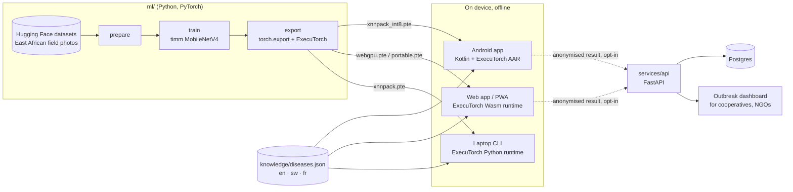

# Architecture

Shamba AI has one rule: the diagnosis runs on the farmer's device. The cloud is optional and never sees a photo.

## System



## The model contract

Every client depends on this contract. `ml/tests/test_contract.py` checks it.

| Item | Value |
|---|---|
| Input | `float32 [1, 3, 224, 224]`, NCHW, RGB, values in `[0, 1]`, contiguous memory |
| Preprocessing in the app | Take the center square of side `short_side * 224 / 256`, scale it to 224 x 224. This equals "resize short side to 256, center crop 224". |
| Normalization | Inside the program (ImageNet mean and std). Apps do not normalize. |
| Output | Softmax probabilities `[1, 14]`. Class order is `manifest.json` `classes`. |
| Thresholds | `confident >= 0.70`, `uncertain < 0.45`, else `likely`. From `manifest.json`. |
| Integrity | Apps verify the sha256 of each `.pte` from `manifest.json` after download. |

Normalization and softmax live in the graph on purpose. Kotlin, JavaScript and Python cannot drift on mean and std values.

ExecuTorch reads raw tensor memory and ignores strides. A non-contiguous tensor gives wrong results without an error. The Python dataset and export check call `.contiguous()`, and a test guards it.

## One model, five programs

`shamba export` lowers the same trained network to these ExecuTorch programs:

| File | Backend | Where it runs | Size |
|---|---|---|---|
| `shamba_crop_health_xnnpack_int8.pte` | XNNPACK, int8 (PT2E static quantization) | Android, laptop CPU | about 2.7 MB |
| `shamba_crop_health_xnnpack.pte` | XNNPACK, fp32 | Android, laptop CPU | about 10 MB |
| `shamba_crop_health_webgpu.pte` | WebGPU (Vulkan delegate family) | Browser GPU | about 10 MB |
| `shamba_crop_health_portable.pte` | none (portable kernels) | Browser CPU fallback | about 10 MB |
| `shamba_crop_health_vulkan.pte` | Vulkan | Android GPU (optional) | about 10 MB |

MobileNetV4-conv-small has only standard ops (conv, depthwise conv, ReLU, mean, linear). All ops go to the delegate on XNNPACK and WebGPU, with zero CPU fallbacks. `manifest.json` records the delegate count and the non-delegated ops for each file.

## Clients

**Android** (`apps/android`). Kotlin, Jetpack Compose, CameraX, `org.pytorch:executorch-android`. The int8 program ships in the APK assets, so the app works offline from the first start.

**Web** (`apps/web`). React 19, Vite 8, a service worker. Inference runs in a Web Worker with the ExecuTorch Wasm runtime from `executorch-community/ExecuTorch-WebGPU-Runtime`. The worker uses the WebGPU program when the device has WebGPU, else the portable program on CPU. The runtime and the program download once (about 17 MB) and are cached for offline use. Laptops use the same web app, installed as a PWA.

**Laptop CLI** (`ml/`). `shamba predict photo.jpg` runs the XNNPACK program with the ExecuTorch Python runtime. Extension officers can batch-check photos.

## Cloud (optional)

`services/api` takes anonymised results: class, confidence, model version, a random install id, and a geohash cut to 5 characters (about 5 km). No photo, no name, no phone number. The outbreak endpoint only returns map cells with at least 5 distinct installs (k-anonymity). Sync is off by default in every app.

`infra/terraform/gcp` deploys the API to Cloud Run (scale to zero) with Cloud SQL Postgres. The web app deploys to GitHub Pages or a Hugging Face static Space.

## Repository layout

```
ml/            data prep, training, export, evaluation, laptop CLI (Python 3.12, uv)
knowledge/     offline advice per disease, three languages (JSON)
apps/web/      PWA with in-browser ExecuTorch (TypeScript, React)
apps/android/  native app with ExecuTorch (Kotlin, Compose)
services/api/  optional sync and outbreak API (FastAPI)
infra/         Terraform for GCP, Hugging Face Space config
docs/          architecture, research, business
.github/       CI, Pages deploy, model release
```

## Decisions

| Decision | Why |
|---|---|
| ExecuTorch, not TFLite or ONNX Runtime | One PyTorch export path for Android, iOS, laptops and the browser. Same `.pte` format everywhere. |
| MobileNetV4-conv-small | 3.8M params, modern (2024), only portable ops, so 100% delegation on XNNPACK and WebGPU. |
| Field photos only (no PlantVillage) | Lab photos on plain backgrounds do not transfer to field photos. |
| Knowledge base, not a generative model, for advice | Advice must be correct and reviewable. Generated text can be wrong. An LLM can come later for follow-up questions, grounded in this base. |
| No sign-in | Sign-in is a barrier on shared and low-end phones. History stays on the device. |
| Confidence in words, urgency in colour + icon + words | Farmers act on "Very likely" and "Act today", not on "0.87". Colour alone fails in sunlight and for colour-blind users. |
